<p align="center">
  
</p>

<h1 align="center">eDent — Dental Education & Practical Work Platform</h1>

<p align="center">
  Full-stack academic platform for dental practical assignments, interactive 9-landmark tooth-image analysis, automated geometric scoring, cohort analytics, and branded PDF reporting.
</p>

<p align="center">
  
  
  
  
  
  
  
</p>

<p align="center">
  <a href="https://github.com/aymenALa/eDent/tree/ui-enhancement"><strong>Full-Stack Source (<code>ui-enhancement</code>)</strong></a>
  &nbsp;•&nbsp;
  <a href="https://github.com/aymenALa/eDent/tree/portfolio-demo"><strong>Portfolio Demo Branch (<code>portfolio-demo</code>)</strong></a>
  &nbsp;•&nbsp;
  <a href="DEPLOYMENT.md"><strong>Deployment Guide</strong></a>
</p>

> **Educational Prototype Disclaimer**: Tooth-angle measurements and scoring use prototype geometric definitions for educational demonstration only. They are not clinically validated and must not be used for clinical diagnosis or treatment decisions.

---

## Table of Contents

- [Application Modes](#application-modes)
- [Architecture Diagrams](#architecture-diagrams)
- [Technology Stack](#technology-stack)
- [Product Screenshots](#product-screenshots)
- [Local Installation — Full-Stack Mode (`ui-enhancement`)](#local-installation--full-stack-mode-ui-enhancement)
- [Local Demonstration Credentials](#local-demonstration-credentials)
- [Local Installation — Browser Portfolio Demo (`portfolio-demo`)](#local-installation--browser-portfolio-demo-portfolio-demo)
- [Project Structure](#project-structure)
- [Security, Testing & Limitations](#security-testing--limitations)
- [Project Authorship](#project-authorship)

---

## Application Modes

eDent supports two distinct runtime modes:

- **Full-Stack Mode** (`ui-enhancement` branch, `VITE_DEMO_MODE=false` or unset):
  - Architecture: **React + Spring Boot + MySQL/TiDB + JWT authentication**.
  - Requires a running backend and database; uses real password/BCrypt login, JWT tokens, and server-side role/ownership enforcement.
- **Interactive Portfolio Demo Mode** (`portfolio-demo` branch, `VITE_DEMO_MODE=true`):
  - Architecture: **React + Centralized Demo Adapter + IndexedDB** (`edent_portfolio_demo`), seeded on first visit from `edent-frontend/public/demo-seed.json` (`55` users, `6` groups, `12` teeth, `10` practical works, `32` group assignments, `54` submissions).
  - **Passwordless Access (`/demo`)**: Visitors can explore as **Administrator**, **Professor**, or **Student** without entering a password or connecting to any backend.
  - **Browser-Local Persistence**: Changes (activations, groups, students, PWs, tooth-image landmark submissions) persist in the visitor's own browser via IndexedDB across refreshes.
  - **Role Switching & Reset**: An in-workspace demo bar lets visitors switch between Admin, Professor, and Student seamlessly or click **Reset demo data** (with confirmation) to restore the initial synthetic dataset.
  - **Sample Tooth Images**: The Tooth Analysis Studio provides sample front/side tooth illustrations in demo mode so visitors can test 9-landmark geometry, scoring, and PDF export without uploading local files.

---

## Architecture Diagrams

### 1. Full-Stack System Architecture (`ui-enhancement`)

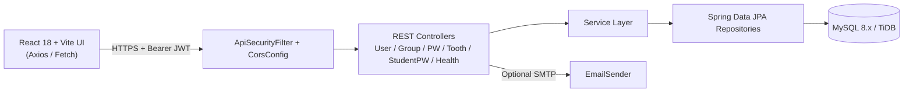

### 2. Browser-Based Portfolio Demo Architecture (`portfolio-demo`)

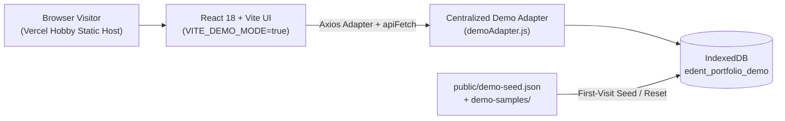

### 3. Role-Based Functionality

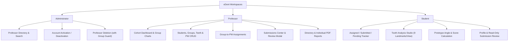

### 4. Student-to-Professor Submission Workflow

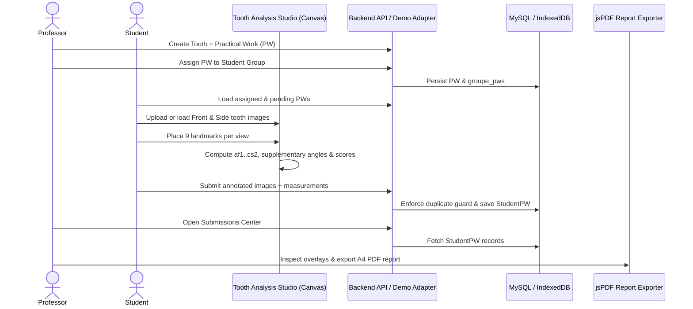

### 5. Authentication & Authorization Flow (Full-Stack Mode)

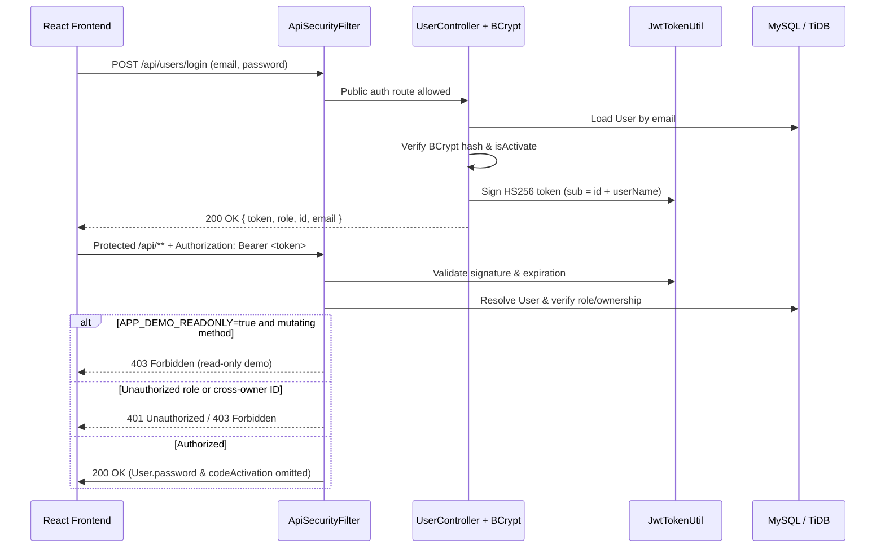

### 6. Database Entity-Relationship Diagram

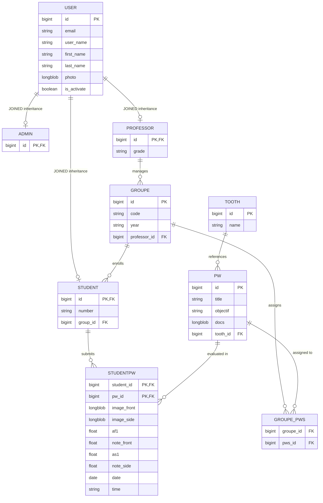

### 7. Deployment Architecture

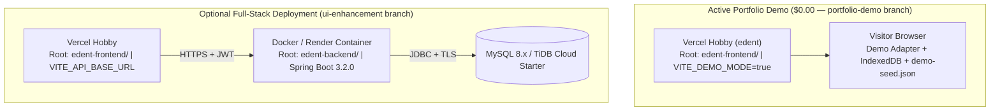

---

## Technology Stack

| Layer | Technology | Verified Version | Purpose |
|---|---|---|---|
| **UI Framework** | React | `18.2.0` | Role-based workspaces, Tooth Analysis Studio, and modal workflows |
| **Build Tool** | Vite | `5.0.0` | Fast HMR dev server and optimized code-split production bundles |
| **Styling** | Tailwind CSS | `3.3.5` | Responsive design tokens (`#0F766E` teal palette, `@tailwindcss/forms`) |
| **Routing & HTTP** | React Router DOM / Axios | `6.20.0` / `1.6.2` | SPA routing, auth header injection, and demo adapter interception |
| **Data Visualization** | Chart.js (`react-chartjs-2`) | `4.4.1` (`5.2.0`) | Professor cohort & group distribution analytics |
| **Annotation & PDF** | HTML5 Canvas / jsPDF / html2canvas | `2.5.1` / `1.4.1` | 9-landmark image overlays, angle calculation, and branded A4 PDFs |
| **Backend Runtime** | Java / Spring Boot | `17` / `3.2.0` | REST API, validation, and static/containerized service execution |
| **Persistence** | Spring Data JPA / MySQL Connector/J | `3.2.0` / `8.2.0` | ORM (`JOINED` inheritance, composite keys) and MySQL/TiDB JDBC |
| **Security** | JJWT / jBCrypt | `0.11.2` / `0.4` | Stateless HS256 Bearer JWT tokens and salted BCrypt password hashes |
| **Containerization** | Docker | Multi-stage | Java 17 JRE Alpine runtime tuned for 512 MB RAM containers |
| **Portfolio Demo** | IndexedDB + `demoAdapter.js` | Browser API | **Demo-only**: persistent browser-local storage without a backend |
| **Hosting** | Vercel Hobby | Static + SPA | Zero-cost frontend hosting with `vercel.json` SPA rewrites |

---

## Product Screenshots

| Professor Dashboard | Submissions Center |
|---|---|
| 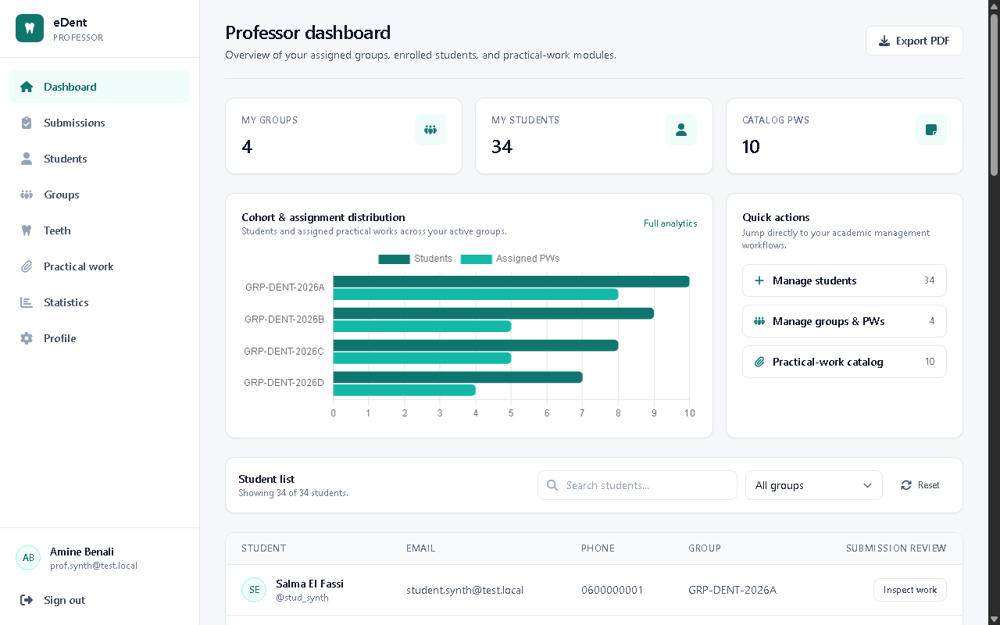 | 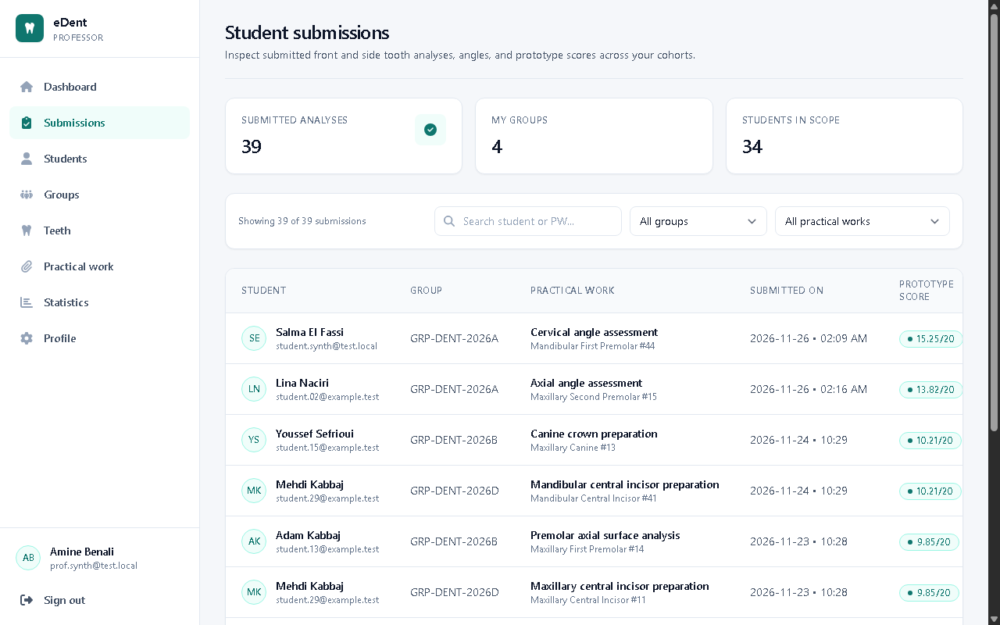 |

| Student Workspace | Tooth Analysis Studio |
|---|---|
| 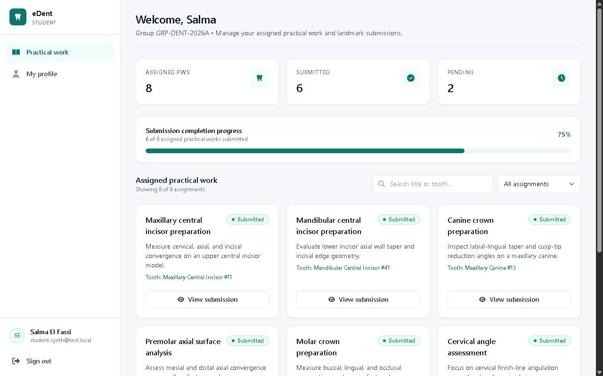 | 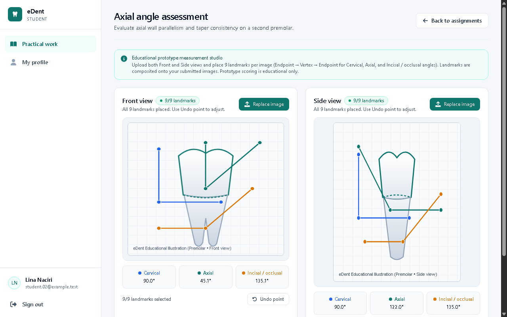 |

<p align="center">
  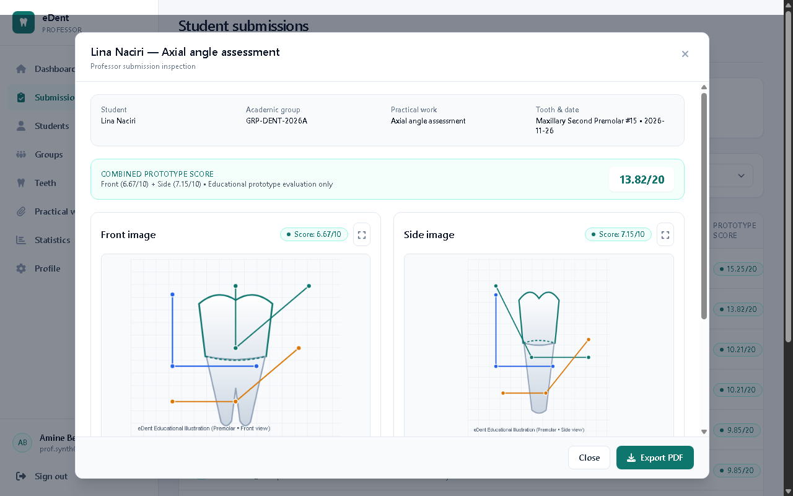
</p>

---

## Local Installation — Full-Stack Mode (`ui-enhancement`)

Use the `ui-enhancement` branch to run the complete **React + Spring Boot + MySQL + JWT** application locally.

### Prerequisites

- **Git**
- **Node.js** `18+` and **npm** (verified with Node `v22.13.1` / npm `10.9.2`)
- **Java** `17+` (targets Java 17; verified with JDK `21.0.4`)
- **MySQL** `8.x`
- **Maven Wrapper** (`mvnw` / `mvnw.cmd` included in `edent-backend/` — no global Maven required)

### Step-by-Step Setup

1. **Clone and switch to `ui-enhancement`**:
   ```bash
   git clone https://github.com/aymenALa/eDent.git
   cd eDent
   git checkout ui-enhancement
   ```

2. **Create the MySQL database and import `edent.sql`**:
   ```sql
   CREATE DATABASE IF NOT EXISTS dents CHARACTER SET utf8mb4 COLLATE utf8mb4_0900_ai_ci;
   ```
   ```powershell
   # Windows PowerShell (default port in application.properties is 3307)
   mysql -h 127.0.0.1 -P 3307 -u root --max_allowed_packet=64M dents < edent.sql
   ```
   ```bash
   # Linux / macOS
   mysql -h 127.0.0.1 -P 3307 -u root --max_allowed_packet=64M dents < edent.sql
   ```

3. **Start the Spring Boot backend (`edent-backend/`)**:
   ```powershell
   # Windows PowerShell
   cd edent-backend
   $env:SPRING_DATASOURCE_URL = "jdbc:mysql://127.0.0.1:3307/dents?serverTimezone=UTC"
   $env:SPRING_DATASOURCE_USERNAME = "root"
   $env:SPRING_DATASOURCE_PASSWORD = ""
   $env:APP_ENV = "dev"
   $env:APP_MAIL_ENABLED = "false"
   $env:CORS_ALLOWED_ORIGINS = "http://localhost:5173"
   # Optional in dev (required >=32 chars when APP_ENV=prod):
   $env:JWT_SECRET = "local-dev-jwt-secret-key-minimum-32-characters"
   .\mvnw.cmd spring-boot:run
   ```
   ```bash
   # Linux / macOS
   cd edent-backend
   export SPRING_DATASOURCE_URL="jdbc:mysql://127.0.0.1:3307/dents?serverTimezone=UTC"
   export SPRING_DATASOURCE_USERNAME="root"
   export SPRING_DATASOURCE_PASSWORD=""
   export APP_ENV="dev"
   export APP_MAIL_ENABLED="false"
   export CORS_ALLOWED_ORIGINS="http://localhost:5173"
   export JWT_SECRET="local-dev-jwt-secret-key-minimum-32-characters"
   ./mvnw spring-boot:run
   ```

4. **Configure and start the React frontend (`edent-frontend/`)**:
   ```powershell
   # Windows PowerShell (new terminal)
   cd edent-frontend
   Copy-Item .env.example .env
   npm install
   npm run dev
   ```
   ```bash
   # Linux / macOS (new terminal)
   cd edent-frontend
   cp .env.example .env
   npm install
   npm run dev
   ```
   Ensure `edent-frontend/.env` has `VITE_DEMO_MODE=false` and `VITE_API_BASE_URL=http://localhost:5050/api`.

5. **Open the application**:
   - Frontend: `http://localhost:5173`
   - Backend API / Health: `http://localhost:5050/api/health`
   - MySQL: `127.0.0.1:3307` (or your configured `SPRING_DATASOURCE_URL` port)

### Optional: Docker Compose (Inspected Configuration)

A root [`docker-compose.yml`](docker-compose.yml) is included for containerized `mysql`, `backend`, `frontend`, and `phpmyadmin` services (`docker compose up --build`). *(Inspected for updated paths; not end-to-end runtime-tested via `docker compose up` in the local sandbox.)*

### Common Startup Troubleshooting

- **MySQL connection refused on `3307`**: If your local MySQL runs on `3306`, set `SPRING_DATASOURCE_URL=jdbc:mysql://127.0.0.1:3306/dents?serverTimezone=UTC`.
- **`APP_ENV=prod` fails to start**: `JwtTokenUtil` enforces a `JWT_SECRET` of at least 32 characters in `prod` mode.
- **SQL import packet error**: Pass `--max_allowed_packet=64M` to `mysql` when importing `edent.sql`.
- **CORS blocked in browser**: Ensure `CORS_ALLOWED_ORIGINS` matches your exact frontend origin (e.g., `http://localhost:5173`).

---

## Local Demonstration Credentials

> **Synthetic Accounts Only**: These accounts are seeded in [`edent.sql`](edent.sql) strictly for local testing and demonstration. Do not reuse them in production.

| Role | Email | Password |
|---|---|---|
| **Administrator** | `admin.synth@test.local` | `SynthAdmin!23` |
| **Professor** | `prof.synth@test.local` | `SynthProf!23` |
| **Student** | `student.synth@test.local` | `SynthStud!23` |

---

## Local Installation — Browser Portfolio Demo (`portfolio-demo`)

Run the interactive portfolio demo **without Java, Maven, or MySQL**:

1. **Clone and switch to `portfolio-demo`**:
   ```bash
   git clone https://github.com/aymenALa/eDent.git
   cd eDent
   git checkout portfolio-demo
   ```

2. **Install dependencies and run with `VITE_DEMO_MODE=true`**:
   ```powershell
   # Windows PowerShell
   cd edent-frontend
   npm install
   $env:VITE_DEMO_MODE = "true"
   npm run dev
   ```
   ```bash
   # Linux / macOS
   cd edent-frontend
   npm install
   VITE_DEMO_MODE=true npm run dev
   ```

3. **Build production bundle**:
   ```bash
   npm run build
   ```

4. **How the Browser Demo Works**:
   - Open `http://localhost:5173` and click **Try live demo** (or **Explore the demo** on the floating welcome card) to enter `/demo`.
   - Select **Administrator**, **Professor**, or **Student** with **no password required**.
   - **Browser-Local Persistence**: Changes are saved in your own browser's **IndexedDB** (`edent_portfolio_demo`, seeded from `public/demo-seed.json`). Different browsers/visitors never share mutable state.
   - **Role Switching & Reset**: Use the top demo bar inside any workspace to switch roles without losing changes, or click **Reset demo data** to restore the initial dataset.
   - **Sample Tooth Images**: Click **Use sample image** in the Tooth Analysis Studio to test 9-landmark geometry and PDF export immediately.
   - **Transparency**: Demo mode does **not** execute Spring Boot, perform real JWT authentication, or connect to MySQL/TiDB.

---

## Project Structure

```text
eDent/
├── edent-backend/                  # Spring Boot 3.2.0 REST API (Java 17)
│   ├── src/main/java/com/dentsbackend/
│   │   ├── config/                 # ApiSecurityFilter (JWT, RBAC, demo guard) & CorsConfig
│   │   ├── controllers/            # REST endpoints (User, Group, PW, Tooth, StudentPW, Health)
│   │   ├── entities/               # JPA entities & JOINED inheritance hierarchy
│   │   ├── repositories/           # Spring Data JPA repositories
│   │   ├── services/               # Domain service layer
│   │   └── utils/                  # JwtTokenUtil, EmailSender, ResetPassword
│   ├── Dockerfile                  # Multi-stage Java 17 build (512 MB RAM tuned)
│   ├── mvnw / mvnw.cmd             # Maven Wrapper
│   └── pom.xml
├── edent-frontend/                 # React 18 + Vite + Tailwind CSS SPA
│   ├── public/
│   │   ├── demo-seed.json          # Sanitized seed dataset (portfolio-demo branch)
│   │   ├── demo-samples/           # Sample tooth illustrations (portfolio-demo branch)
│   │   ├── showcase/               # Application screenshots
│   │   └── favicon.svg             # Official eDent SVG brand mark
│   ├── src/
│   │   ├── components/             # Role workspaces, demo welcome UI, shared UI kit
│   │   ├── demo/                   # IndexedDB demoStore & demoAdapter (portfolio-demo branch)
│   │   ├── layouts/                # AppShell & AuthLayout
│   │   ├── pages/                  # LandingPage, DemoAccess
│   │   └── utils/                  # api.js, annotationCanvas.js, pdfExport.js
│   ├── vercel.json                 # React Router SPA rewrite configuration
│   └── package.json
├── edent.sql                       # Sanitized synthetic MySQL demonstration dataset
├── docker-compose.yml              # Local multi-container setup
├── DEPLOYMENT.md                   # Zero-cost Vercel & optional full-stack deployment guide
└── README.md
```

---

## Security, Testing & Limitations

- **Full-Stack Security Controls (`ui-enhancement`)**:
  - **JWT Authentication & RBAC**: `ApiSecurityFilter` validates HS256 Bearer tokens via `JwtTokenUtil` (`JWT_SECRET` externalized via env var; startup fails if `< 32` chars when `APP_ENV=prod`), enforcing Admin/Professor/Student role and ownership boundaries.
  - **Password & Secret Protection**: BCrypt password hashing (`jBCrypt`), `@JsonProperty(access = WRITE_ONLY)` on `User.password` and `User.codeActivation`, explicit `CORS_ALLOWED_ORIGINS` via `CorsConfig`, and SMTP disabled unless `APP_MAIL_ENABLED=true`.
  - **Optional Read-Only Backend Guard**: `APP_DEMO_READONLY=true` blocks mutating HTTP methods (except `/api/users/login`) with `403 Forbidden`.
- **Verified Build & Test Status**:
  - Frontend production builds pass cleanly for both `VITE_DEMO_MODE=true` (`502` modules) and `VITE_DEMO_MODE=false`.
  - `npm run lint` passes with zero errors in all modernized/demo files (`27` pre-existing lint issues remain in untouched legacy template files).
  - Backend `mvnw.cmd clean test` (`DentsBackEndApplicationTests`) and HTTP security/CORS/RBAC checks passed against the isolated `edent_test` MySQL 8.2 database.
  - The interactive portfolio demo was manually tested and accepted by the product owner; automated headless Chrome attachment was unavailable locally because Chrome remote debugging (`DevToolsActivePort`) was not enabled.
- **Limitations & Historical Note**:
  - Geometric angles and `scoreAngles` values are educational prototypes, not clinically validated medical metrics.
  - Pre-modernization commits in `main` history remain preserved (not rewritten); any previously committed development credentials should be rotated.

---

## Project Authorship

Developed and maintained by **Aymen Alioua**.
